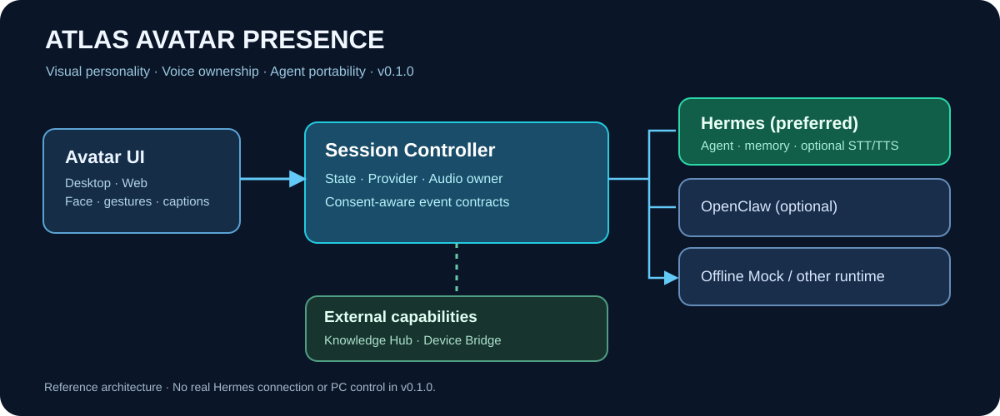
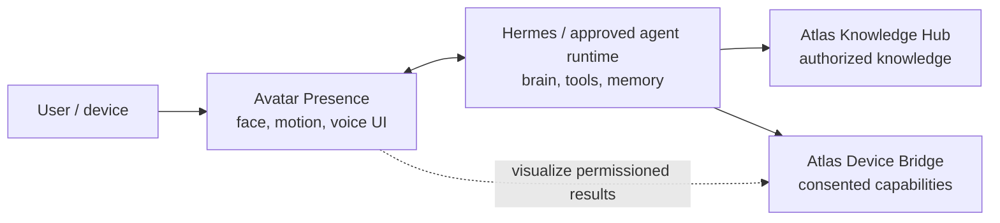

# Atlas Avatar Presence (AAP)

> **AtlasHub.SI — Visible AI Experts, one agent intelligence, multiple interfaces.**  
> Architecture, reference contracts and executable browser proof-of-concept  
> **v0.1.0 · 2026-10-10 · Status: foundation / research + offline demo; no Hermes deployment**

[](https://github.com/atlashub-digital/Atlas-Avatar-Presence/actions/workflows/quality.yml)



**Atlas Avatar Presence** represents existing or future AtlasHub agents as visible, animated, voice-capable digital characters across PC, browser, mobile and TV. AAP owns the **presentation layer**, not the agent's intelligence, memory, knowledge, desktop permissions or customer information. It can use **Hermes as the authoritative agent and audio provider**, or an explicitly configured alternate runtime such as OpenClaw, while keeping stable contracts for visual events and characters.

**Pilot goal:** make Helena *visibly present and conversable* on an authorized Windows machine at minimal incremental cost. The first delivered demo is deliberately **browser-only and offline**; it does not yet connect to the real Helena, capture a desktop, control other applications or ship a Windows installer.

## Start here

| Audience | Reading path |
| --- | --- |
| Executive/product | [Vision](docs/01-vision-and-boundaries.md) → [Decision matrix](docs/03-technology-options.md) → [Costs](docs/11-cost-and-performance.md) |
| Codex/engineering | [AGENTS.md](AGENTS.md) → [Architecture](docs/02-architecture.md) → [Contracts](docs/04-contracts.md) → [Implementation tickets](docs/14-codex-work-orders.md) |
| Hermes integrator | [Voice ownership](docs/05-audio-and-voice.md) → [Hermes adapter](docs/06-hermes-integration.md) |
| OpenClaw integrator | [OpenClaw adapter](docs/07-openclaw-and-other-runtimes.md) → [Device Bridge](docs/08-device-bridge-and-knowledge.md) |
| Character/visual team | [Character and media system](docs/09-character-system.md) |
| QA/security | [Security](docs/12-security-and-consent.md) → [Acceptance tests](docs/15-acceptance-and-quality.md) |
| Everyone | [Document index](docs/INDEX.md) · [Decision log](docs/adr/ADR-0001-presentation-separation.md) · [CHANGELOG](CHANGELOG.md) |

## Boundaries



### Ownership matrix

| Concern | Canonical owner | AAP does |
| --- | --- | --- |
| Personality, memory, tools, session | Hermes / AI Workforce | Pass authenticated turn/event metadata and render state |
| Audio capture + STT + TTS | **Hermes by default** | Reflect microphone state; render/reproduce only one selected audio stream |
| Voice from other engine | Configured voice adapter | Use only when Hermes does not own playback or an approved handoff exists |
| Face, gestures, lip sync, desktop overlay | AAP | Render avatar / display transitions |
| Physical PC/mobile/TV actions | [Atlas Device Bridge](https://github.com/atlashub-digital/Atlas-Device-Bridge) | Request via bridge after policy; never act directly |
| Enterprise / industry / customer knowledge | [Atlas Knowledge Hub](https://github.com/atlashub-digital/Atlas-Knowledge-Hub) | Never access the KB directly from a public avatar |
| Client/agent deployment | [AtlasHub AI Workforce](https://github.com/atlashub-digital/AtlasHub-AI-WaaS) | Respect identity and binding |

## What is actually runnable now

```bash
git clone https://github.com/atlashub-digital/Atlas-Avatar-Presence.git
cd Atlas-Avatar-Presence
npm test
npm run demo
npm run check:docs
```

Open [`apps/web-demo/index.html`](apps/web-demo/index.html) in a desktop browser for a **synthetic 2D animated Expert** with idle/listening/thinking/speaking status, optional browser-based local speech demo and explicit microphone-state controls that do **not** record audio. The sample uses **no paid API, no external JS/CDN, no video/screen capture, no client identifiers and no real agent connection**.

The core reference includes a provider-neutral orchestration contract, an offline mock, *transport-injected* Hermes and OpenClaw adapter shims, explicit audio ownership and Node native tests. These adapters intentionally **do not** assume an undocumented deployed gateway wire format.

### Implementation status

- **Implemented in this repo:** study, architecture, JSON Schemas, reference event/state controller, mock adapter, transport-injected adapter interfaces, offline visual demo, tests, CI.
- **Not implemented:** actual Hermes auth/connection, native VRM renderer, ARPA control, Electron Windows installer, device capture, microphone pipeline, actual streaming lip sync, OpenClaw runtime connectivity, cloud hosting.
- **References, not dependencies:** [ARPAHLS/avatar](https://github.com/ARPAHLS/avatar), [pixiv/three-vrm](https://github.com/pixiv/three-vrm), [NousResearch/hermes-agent](https://github.com/NousResearch/hermes-agent), [openclaw/openclaw](https://github.com/openclaw/openclaw), [LiveKit Agents](https://github.com/livekit/agents), others in [References](docs/references.md).

## Proposed delivery track

- **v0.1** — research and code-contract baseline (this commit).
- **v0.2** — Windows sandbox overlay with a licensed test VRM, animation and safe local controls.
- **v0.3** — authenticated Hermes identity/session + voice handoff, proven with Helena profile; no duplicate TTS.
- **v0.4** — expression mapping, measured latency and audio lip sync; character asset provenance.
- **v0.5** — optional Device Bridge consented observations, knowledge access through *agent*, not avatar.
- **Later** — web workspace embed, mobile own-app experience, TV/teacher, LIA, multi-client packaging; gated by economics and privacy tests.

## Public repo warning

Public temporarily for ease of access. **Do not add** private models of real people without rights, actual customer data, private Drive links, agent secrets, unredacted logs, VPS endpoints or recorded voices. If made private later, previous Git clones and forks cannot be recalled.

See [LICENSE NOTE](docs/16-licensing-and-assets.md): this new repository intentionally does not assert that third-party characters, models, voices or code are licensed for reuse.
