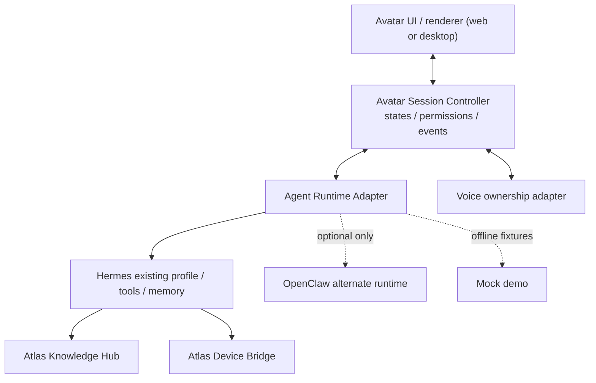
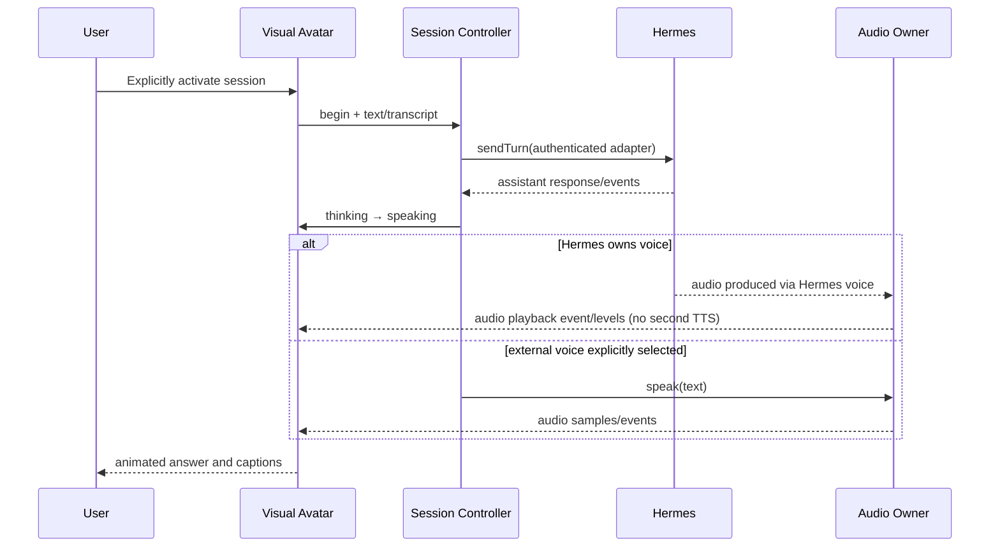

# AAP-ARCH-001 · Component architecture

**Status:** PROPOSED target / OFFLINE reference implemented.

## Three independent planes

1. **Visual**: renderer (VRM, 2D, native renderer) maps state/events into expressions and displays captions. No confidential agent access keys.
2. **Conversational + voice**: approved agent runtime handles reasoning, tool and memory. Voice controller selects exactly one STT/TTS authority. For Hermes profile use Hermes STT/TTS where compatible.
3. **Capabilities**: knowledge retrieval by agent via AKH, device observation/action via ADB. No direct privileged app controls inside AAP.

## Event flow

## Adapter interfaces
- Agent: `sendTurn({sessionRef,text,signal}) -> {text,audioRef?,events?}`.
- Voice: `speak(text,ctx)` only when session audio authority is external; otherwise attach to Hermes stream or system-audio levels without resynthesis.
- Renderer: `setState(state)` + `renderText(text)` and optional `setAudioLevels(levels)`.
- Device: *never* direct OS APIs in renderer. Commands route via separately authorized Device Bridge capability.
- Identity: deployment/tenant/profile come from authenticated backend session; never trust browser-selected tenant.

## Deployment
Local avatar window and rendering on PC. Hermes remains in its approved runtime. Authenticated link over private secure transport; no new GPU/VPS needed for a test with synthetic visuals. Production may require a small session relay, never anonymous public gateway.

## Critical nuance
ARPA desktop app can lip-sync on selected device output, but if it listens to *all* system audio, it can animate while unrelated videos play. Commercial design must bind lip-sync to the **authorized agent audio stream**, not indiscriminate system loopback.
