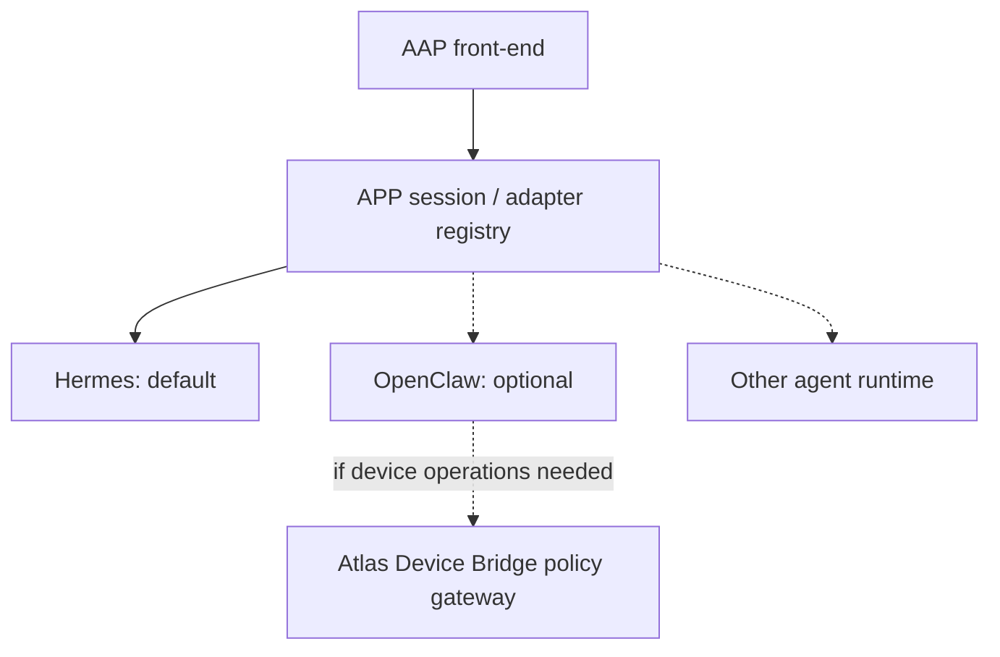

# AAP-ALT-001 · OpenClaw and extensible runtimes

**Status:** adapter shim implemented; **no OpenClaw integration/deployment**.

OpenClaw may be used in two different roles, which must not be confused:
1. **Alternative conversational backend** for AAP, chosen by authorized user/deployment.
2. **Optional device node adapter** behind **Atlas Device Bridge**, where device policy remains authoritative.

The AAP renderer never calls unrestricted `node.invoke` or `system.run` directly. OpenClaw devices require separate pairing, consent and capability grants. Consult official [OpenClaw code](https://github.com/openclaw/openclaw) and [computer-use docs](https://github.com/openclaw/openclaw/blob/main/docs/nodes/computer-use.md).

The [`createOpenClawAdapter`](../src/adapters/openclaw.mjs) function mirrors the Hermes port with an injected transport and no hidden API assumptions. A provider switch is a deliberate session choice. It must never silently copy Hermes memory, credentials or user profile.

## Additional runtime candidates
LangGraph/agent platform, custom AI-WaaS managed runtime and pure mock may implement the same `sendTurn` port. Audio remains separately configured and access-controlled.

## Compliance contract
Feature gate per runtime, explicit auth, role/deployment binding, selected voice ownership, event version, cancellation support, safe error handling and tenant A/B leakage tests before deployment.
